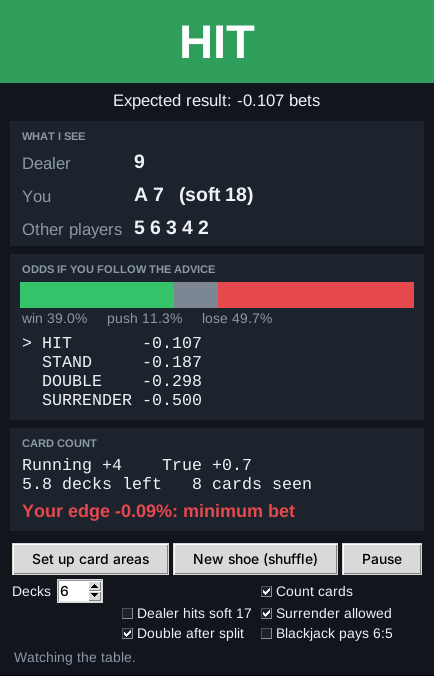

# Blackjack screen advisor

Reads the blackjack table on your screen, counts every card it sees, and tells
you the play with the best odds.

- **Pure probability.** No strategy chart is looked up. For every legal move
  (stand, hit, double, split, surrender) it computes the exact expected value
  and the win / push / lose odds from the chance of each card being drawn next.
- **Card counting.** It reads your cards, the dealer's and the other players',
  removes each one from the shoe, and recalculates the odds from the cards that
  are actually left. It also shows the Hi-Lo running and true count, whether
  insurance is worth taking, and your edge on the next hand (when to bet more).
- **Advice only.** It never clicks or bets for you.

## Install

Python 3.10+ is required.

```bash
pip install -r requirements.txt
```

On Linux the overlay window also needs Tk (`sudo apt install python3-tk python3-pil.imagetk`).

## Use



1. Open your blackjack game so the table is visible.
2. Start the bot. Either double-click `start_bot.bat` (Windows) or
   `start_bot.command` (Mac), or run:

   ```bash
   python -m blackjack_bot
   ```

   A window opens and stays on top of your game. Drag it somewhere it does not
   cover the cards.
3. Click **Set up card areas**. Your screen freezes: drag a box around the
   dealer's cards, then your cards, then one box per other player, and press
   Enter (or right-click). Make each box big enough to hold a hand after
   several hits, with the whole card inside it. This is saved for next time.
4. Play. The window shows:
   - the move to make, in large letters (HIT, STAND, DOUBLE, SPLIT, SURRENDER);
   - the cards it sees for the dealer, you and the other players;
   - your win / push / lose odds, and the expected result of every move
     (`-0.107` means losing 10.7% of your bet on average);
   - the card count, and whether to raise your bet on the next hand.
5. When the dealer shuffles, click **New shoe (shuffle)** to reset the count.

The tick boxes set the table rules; **Decks** is the number of decks in the shoe.
Untick **Count cards** for games that reshuffle every hand.

### Command-line options

The same settings can be given when starting, e.g. `python -m blackjack_bot --decks 8 --h17`.

| Option | Meaning |
| --- | --- |
| `--decks N` | decks in the shoe (default 6) |
| `--no-count` | ignore seen cards; use for games that reshuffle every hand |
| `--h17` | dealer hits soft 17 (default: stands) |
| `--no-das` | no double after split |
| `--no-surrender` | surrender is not offered |
| `--bj-payout 1.2` | blackjack pays 6:5 instead of 3:2 |
| `--no-overlay` | no window; print to the terminal |
| `--interval 0.4` | seconds between screen reads |

### Other commands

```bash
python -m blackjack_bot advise 10 6 --dealer 10
```

```bash
python -m blackjack_bot image shot.png --dealer 440,40,420,260 --player 440,400,420,260 --others 20,360,400,200
```

`advise` works from cards you type; `image` analyses a saved screenshot, which
is the quickest way to check that your game's cards are recognised.

## Live-dealer tables

Live tables (a video of a real dealer) show two kinds of cards:

- **Small on-screen cards** for the dealer and for your own hand. These are
  what the bot reads. Box just those small cards when setting up; leave the
  total badge and the video out as far as you can.
- **Physical cards on the video table** for the other seats. These are tilted,
  small and blurred by the video, and the bot cannot read them. Do not box
  them. The count then uses the dealer's cards and yours only. It is still
  mathematically correct, just built from fewer cards, so it moves more slowly.

If the window shows the wrong cards or CAN'T READ, click **Save what I see**.
It writes each card area as a picture, plus what was read, into a `debug`
folder next to the bot, which shows exactly what went wrong.

## What to know

- **Counting only helps with a real shoe** (live-dealer or physical tables).
  Software (RNG) blackjack reshuffles before every hand, so there is nothing
  to count: use `--no-count` there. Games using a continuous shuffling machine
  are the same.
- The bot cannot see a shuffle. Reset the count yourself, or it will keep
  counting against the old shoe. It warns if it sees more of a card than the
  shoe can hold.
- The count starts when the bot starts. Cards dealt before that are unknown.
- Card recognition expects upright, light card faces with the rank in the
  top-left corner, side by side or overlapping sideways. A card it is not sure about is
  shown as `?` and no advice is given, rather than guessing. It has been tested
  on rendered tables, not on every casino skin: check yours with `image` first.
- One hand of yours is read. After a split, use `advise` for each hand.
- Model details: draws are treated as independent at the current shoe
  composition, the dealer peeks for blackjack, and a pair can be split once.
- Many casinos forbid assistance tools in their terms; using one can get an
  account closed. Even perfect counting gives an edge of roughly 0.5-1%, with
  large swings.

## Tests

```bash
python -m pytest
```
